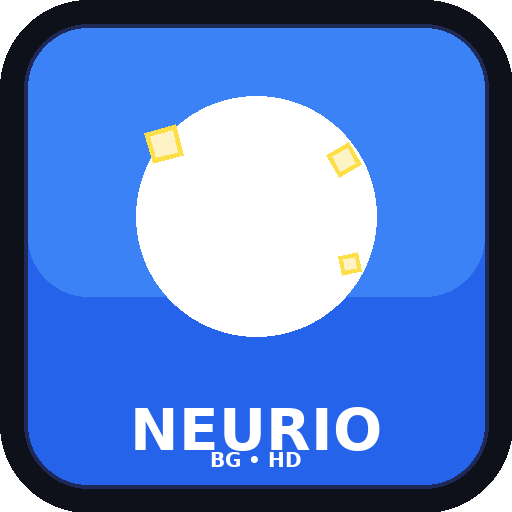

# ✨ Neurio — Hayed Background + Zid Quality

**EXE dyal PC — ta3tih taswira → yhayed background (transparent) → yzid quality HD 2×/4× → thfed PNG/JPG/WEBP**

> App zwina b PySide6 (Qt) — dark mode, drag & drop, preview qbel/men ba3d, batch, w web demo. Kaykhdem offline 100% men ba3d awal marra. CLI khedam headless l automation.



---

## 🚀 Chouf Demo daba (bla ma tinstalli walo)

**Web demo — khedam f browser:**

```bash
pip install -r app/requirements.txt
python app/web_app.py
# → http://localhost:7860  (drag & drop taswira w jareb!)
```

**Desktop EXE — 1 click build:**

```bash
pip install -r app/requirements.txt
python app/build.py          # → dist/Neurio.exe (Windows) / dist/Neurio (Linux/Mac)
./dist/Neurio                # double-click
```

> Awal marra: model U2Net (~176MB) kayt-telechargi (khass internet). Men ba3d kaykhdem offline.

---

## 📥 T7mil EXE jahz (Windows)

1. Sir l **Releases** (aw `dist/` men ba3d build)
2. Telechargi `Neurio.exe`
3. Double-click — makay7tajch installation, makay7tajch Python
4. Jor taswira → **Hayed Background** ✂️ → **Zid Quality** ✨ → **Hfed** 💾

📖 Guide kamil: [`app/README.md`](app/README.md) — fih kolchi b Darija + Français + English  
🛠️ Build details: `python app/build.py --help`

---

## 🎯 Ach kaydir?

| Feature | Description |
|---|---|
| **✂️ Hayed Background** | rembg U2Net / ISNet / Human-seg → PNG transparent nqi, kay7afed sha3r w details |
| **✨ Zid Quality** | Upscale 1×/2×/4× LANCZOS + denoise (OpenCV) + sharpen + auto color/contrast |
| **⚡ Bjouj** | BG + HD f nafs lwa9t — asra3 |
| **🎨 Preview** | Qbel/men ba3d, checkerboard l transparency, info  W×H |
| **💾 Save** | PNG transparent / JPG fond blanc / WEBP optimisé |
| **🖱️ UX** | Drag & drop, click l preview, sliders, batch CLI |
| **🖥️ Offline** | Kolchi local, 7ta SFX makaynch — 0 CDN |

**Natija:**

| Input | Output (BG mhayed + HD 2×) |
|---|---|
| `photo.jpg` 900×700 | `photo_neurio.png` 1800×1400 transparent + sharp |

Examples generated: `app/examples/` — `input_product.jpg` → `output_*_both.png` (1800×1400)

---

## 🖥️ App Desktop — Kifach tkhdem

1. **Khtar Taswira** 📁 — click aw drag & drop (JPG/PNG/WEBP/BMP/TIFF)
2. **Hayed Background** ✂️ — model: `u2net` 3am / `u2net_human_seg` bnadm / `isnet` pro
3. **Zid Quality** ✨ — scale 1×/2×/4×, sharpen 0.5×–2.5×, denoise, zid lawn
4. **Bjouj ⚡** — dirhom bjouj (recommended)
5. **Hfed 💾** — khtar format w hfed — PNG transparent by default

Options f lta7t: Tkabir, Sharpen slider, Denoise checkbox, Zid Lawn.

> 💡 Tip: `isnet-general-use` ahsan f sha3r, walakin t9il. `u2net` mzyan bzaf l 90% dyal tasawer.

---

## ⌨️ CLI — l automation / batch

```bash
# BG + enhance 2× (default)
python app/main.py --cli input.jpg -o out.png --scale 2

# Ghir BG
python app/main.py --cli input.jpg -o out.png --no-enhance

# Ghir HD 4× bla BG removal
python app/main.py --cli input.jpg -o out.png --no-bg --scale 4 --sharpen 1.5

# Batch Windows PowerShell
Get-ChildItem *.jpg | ForEach-Object { python app/main.py --cli $_.FullName -o "$($_.BaseName)_neurio.png" }

# Batch Linux/Mac
for f in *.jpg; do python app/main.py --cli "$f" -o "${f%.jpg}_neurio.png" --scale 2; done
```

---

## 🛠️ Sna3 EXE dyalk (Windows / Mac / Linux)

```bash
# 1. Python 3.10+ (python.org)
python -m venv venv
# Windows: venv\Scripts\activate
# Linux/Mac: source venv/bin/activate

pip install -r app/requirements.txt

# 2. Build onefile (1 exe, sahla l partage)
python app/build.py              # → dist/Neurio.exe (~150MB)

# 3. Aw build onedir (dossier, asra3 f l7el)
python app/build.py --onedir     # → dist/Neurio/Neurio.exe

# 4. Test
./dist/Neurio                     # double-click
```

**Tech:** PySide6 Qt6 + Pillow + opencv-headless + rembg (onnxruntime) + PyInstaller

**Icon:** `app/icons/neurio.ico` auto-generated

**Spec:** `app/Neurio.spec` — onefile, windowed (bla console), collect rembg/onnx

---

## 📂 Structure

```
neurio/
├── app/                      # ✨ Neurio — Hayed Background + Zid Quality
│   ├── main.py               # Desktop GUI (PySide6) + CLI --cli mode
│   ├── processor.py          # Core: remove_bg + enhance_quality (fallback)
│   ├── web_app.py            # Web demo (http.server, no Qt needed)
│   ├── build.py              # One-click exe builder
│   ├── Neurio.spec           # PyInstaller spec (onefile, windowed)
│   ├── requirements.txt
│   ├── icons/                # neurio.png / neurio.ico (generated)
│   ├── examples/             # input/output samples (auto-generated)
│   └── README.md             # Guide kamil + FAQ
├── index.html                # 🏁 Bash Baqi Racing (game)
├── src/ ...                  # Game sources
├── vendor/ three.module.js   # Game deps
└── README.md                 # (this file)
```

---

## ❓ FAQ

**Q: Wach kaykhdem bla internet?**  
A: Ah! Men ba3d awal marra (model 176MB download). Kolchi local.

**Q: EXE 150MB 3lach kbir?**  
A: Fih Python + Qt + onnxruntime + opencv + model. Normal. Onefile = 1 fichier sahl l sift. Onedir = asra3.

**Q: Wach kay9ta3 sha3r mzyan?**  
A: `isnet-general-use` ahsan. Settings → model → isnet. Alpha matting option kaina f code.

**Q: Input/output formats?**  
A: Input: JPG/PNG/WEBP/BMP/TIFF/GIF. Output: PNG (transparent) / JPG (blanc) / WEBP (sghir).

**Q: Kayn batch?**  
A: Ah — CLI batch loop (foq). GUI batch jay f v2.

**Q: Linux ma3andouch GUI?**  
A: Khedem web demo: `python app/web_app.py` → browser. Nafs engine.

---

## 🎨 Examples

Generated via `app/examples/generate_examples.py` (Pillow, 100% offline):

- `input_product.jpg` (900×700) → `output_input_product_both.png` (1800×1400) — fallback BG removal + HD
- `input_portrait.jpg` (700×900) → `output_input_portrait_both.png` (1400×1800)

Jarebhom: `python app/main.py --cli app/examples/input_product.jpg -o /tmp/demo.png --scale 2`

---

## 🏁 Bonus: Bash Baqi Racing — 3D Kart Game

Hadi l repo kant fiha lo3ba — b9at kaina! L3abha men hna:

**▶ Play:** `python3 -m http.server 8000` → http://localhost:8000

لعبة سباق كارت ثلاثية الأبعاد كاملة بالمتصفح — سيارات باغي على الشاطئ، متجر، بطولة، وخرائط عشوائية!
A full 3D kart-racing game in the browser — beach buggies, huge shop, championship, random tracks!

**▶ Play:** serve the folder with any static server and open it:

```bash
python3 -m http.server 8000
# → http://localhost:8000
```

No build step, no external CDN — everything is procedural and vendored (Three.js r170 included in `vendor/`).

---

### 🎬 فيديو ترويجي — 60 ثانية أنيميشن

A **1-minute vertical cartoon trailer** (1080×1920, 24 fps) with a fully synthesised
soundtrack is included: **[`video/bash-baqi-racing-60s.mp4`](video/bash-baqi-racing-60s.mp4)**

title card → beach cruise → dune ramp backflip → `TURBO!` duel overtake → `FINISH` + trophy → sunset logo card.

Everything is generated from code (no stock footage/music):

```bash
python3 tools/video/audio.py  --out /tmp/track.wav      # music + SFX synth
python3 tools/video/cartoon.py --encode video/bash-baqi-racing-60s.mp4 --audio /tmp/track.wav
```

See **[`tools/video/README.md`](tools/video/README.md)** for the scene timeline and all the knobs.

---

### 📱 Install on your phone — كأنها APK!

The game is a full **PWA** (Progressive Web App): installable, fullscreen, **works offline**, its own icon — no APK file needed.

1. Open the game link on your phone (Chrome on Android / Safari on iPhone)
2. Tap **📱 Install** button inside the game's garage, **or** browser menu `⋮` → **"Add to Home screen" / "تثبيت التطبيق"**
3. Done — the 🏁 buggy icon sits on your home screen and launches **fullscreen like a real app**

> **Want a real `.apk` file?** Host this repo anywhere public (e.g. enable **Settings → Pages → Deploy from branch** in GitHub — one tap), then go to **pwabuilder.com** on your phone, paste the link, and it gives you a signed APK to download. No PC needed.

**Offline play** is built-in: a service worker caches all game files on first visit.

---

### 🎮 The Game

You are dropped **straight into a race** the moment the game loads. Finish, earn, upgrade, repeat!

- 🏎️ **50 cars to buy** — micros, beach buggies, muscle cars, monster trucks, hotrods, super sports (3 ultra-rare 💎 gem cars)
- 🧑‍🤝‍🧑 **16 drivers** — from Zaid 😎 to Nova the alien 👽
- 🗺️ **50 random tracks** across 10 worlds: Beach, Jungle, Desert, cobblestone Town at sunset, Snow, Volcano, Swamp, Canyon, Farm, and Stardust Night 🌙
- 🥇🥈🥉 **Place 1st–3rd** for big rewards — every place pays coins, top 3 pays gems, 1st wins a 🏆
- 🪙 Coins also sit **on the track** — grab them mid-race
- 🏆 **Championship season**: points (10/8/6/4/2/1) every race vs 5 rivals; champion after 10 races wins a jackpot
- 📦 **? item boxes**: 🔥 turbo boost · 🚀 homing rocket · 🛡️ bubble shield
- 🔧 **Garage**: upgrades (top speed / acceleration / handling), paint shop, wheels, horns
- 💾 Progress auto-saves in the browser

### 🕹️ Controls

| Action | Keys |
|---|---|
| Drive | `W A S D` / arrows (auto-gas on mobile) |
| Power-up | `SPACE` |
| Reset on track | `R` |
| Horn | `H` |
| Pause | `ESC` |

Touch buttons appear automatically on phones/tablets.

### 🧱 Tech — 100% procedural

- **Three.js r170** (vendored, zero runtime dependencies) with a hand-written **bloom pass** (threshold + separable blur + filmic composite + vignette)
- Every track is generated from a seeded closed Catmull-Rom spline: road ribbon mesh, terrain sculpted *away from the spline*, themed decor merged into single draw calls, start-line arch, item boxes, coins, hot-air balloons 🎈
- Cars & chibi drivers are built from primitives (8 car archetypes, 16 hat styles, emoji faces)
- All SFX + the island music loop are synthesized live with the Web Audio API — zero audio files
- Arcade kart physics: grip/drift model, off-road slowdown, rubber-banding AI, homing rockets, spin-outs, dust particles

```
neurio/
├── index.html            # UI layers (HUD, menus, shop, results)
├── src/
│   ├── main.js           # state machine + renderer + economy
│   ├── race.js           # race engine: physics, AI, powerups, HUD
│   ├── menu.js           # garage scene + shop/drivers/customize/upgrades/series
│   ├── builders.js       # 3D builders: cars, drivers, track worlds
│   ├── data.js           # 50 cars · 16 drivers · 50 maps · 10 themes · economy
│   ├── tex.js            # canvas textures (roads, skies, faces…)
│   ├── audio.js          # synth engine/sfx/music
│   ├── post.js           # bloom post-processing
│   ├── save.js           # localStorage persistence
│   └── util.js           # seeded RNG + helpers
└── vendor/               # three.js r170 (no internet needed)
```

Made with ❤️ and Three.js

---

### 📦 `BashBaqiRacing.apk` — ملف جاهز!

A **ready-to-install Android APK** is included in this repo (built offline with aapt2 + ecj + d8 + apksigner, no Gradle — see `tools/`).
It's a fullscreen WebView shell that runs the bundled single-file game 100% offline.

**Install on a phone:**
1. Download `BashBaqiRacing.apk` onto your phone.
2. Tap it → allow **"Install from unknown sources"** (once).
3. Play — icon 🏁 sits on your home screen, works offline.

- Package: `com.bashbaqi.racing` · minSdk 21 (Android 5.0+) · signed v1+v2
- Rebuildable: `node tools/build-singlefile.mjs` regenerates the bundled game (`bash-baqi-racing.html`); the APK pipeline lives in the repo history.

---

Made with ❤️ — Neurio + Bash Baqi Racing
