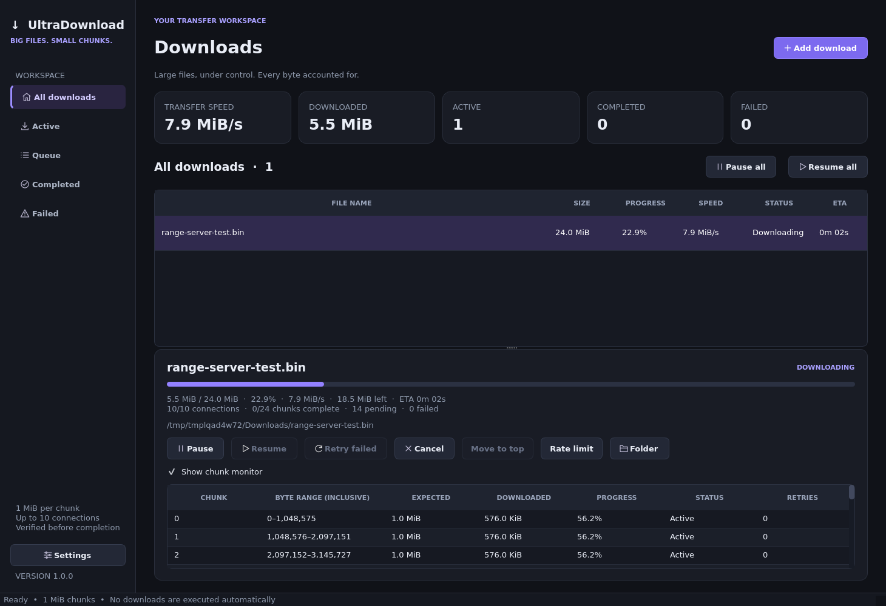

# UltraDownload

**A real PySide6 desktop download manager for large direct-URL files.**

Fixed **1 MiB (1,048,576-byte) chunks**, at most **10 concurrent chunk requests per file**, a bounded scheduler, persistent SQLite state, and streamed, verified file assembly. The original repository's browser application is preserved; this directory is an independent desktop project.



*Actual Qt application, downloading a 24 MiB local test file with ten active connections. This is not simulated progress.*

## Build status — read first

- The source application and real HTTP-transfer tests have been run on **Linux, Python 3.11**. Qt was exercised using its offscreen platform, including a GUI-driven download.
- Windows EXEs are built by GitHub Actions, not by cross-compiling on Linux. The workflow publishes a direct-download prerelease only after source tests and packaged-EXE checks pass. Windows 10/11 interactive verification and code signing remain release tasks.
- `build.bat` and the GitHub Actions workflow build a **standalone Windows x64 EXE**, run the tests **before** packaging, then launch and exercise the **packaged EXE**. Users of a successfully built EXE do **not** need Python installed.
- See [TESTING.md](TESTING.md) for actual validation, coverage, and the remaining Windows release checklist. This is implemented source, not a UI mockup or a claim of a certified production release.

## Quick start on Windows

For development/building, install **Python 3.12 x64** with the Python launcher. End users only need the built EXE.

```bat
cd UltraDownload
py -3.12 -m venv .venv
.venv\Scripts\python -m pip install -r requirements.txt
.venv\Scripts\python main.py
```

Build and test a standalone EXE:

```bat
build.bat
```

Successful output:

```text
dist/UltraDownload.exe
dist/UltraDownload.exe.sha256   (artifact identity hash, not a signature)
dist/exe-self-test.json         (actual packaged-executable test result)
```

The build uses PyInstaller's **one-file, windowed** mode, with a multi-resolution icon and Windows version metadata. All failure exits are propagated; a failing test does not proceed to packaging. No administrator privileges are needed for normal operation.

### GitHub Actions

`.github/workflows/ultradownload-windows.yml` runs on Windows Server 2022 with Python 3.12 x64 when these source files are pushed or a relevant PR is opened. It can also be run manually. After a **successful run**, download the **UltraDownload-Windows-x64** artifact from the run's artifact list. Successful runs from this development branch also publish the EXE as a GitHub release asset. Windows Server testing is not a substitute for interactive Windows 10 and 11 testing.

### Linux source development

Python 3.11–3.13 is compatible with the pinned direct dependencies. On Debian/Ubuntu, Qt needs native system libraries in addition to the Python wheels:

```bash
sudo apt-get install libgl1 libegl1 libxkbcommon0 libdbus-1-3 libxcb-cursor0 \
  libxkbcommon-x11-0 libxcb-icccm4 libxcb-image0 libxcb-keysyms1 \
  libxcb-render-util0 libxcb-xinerama0 libxcb-xkb1
python3 -m venv .venv
.venv/bin/pip install -r requirements.txt
.venv/bin/python main.py
```

A graphical desktop session is needed for ordinary use. For automated GUI tests on a headless host:

```bash
QT_QPA_PLATFORM=offscreen .venv/bin/python -m pytest -q
QT_QPA_PLATFORM=offscreen .venv/bin/python main.py --smoke-test --data-dir /tmp/ud-smoke
```

The offscreen platform still requires Qt's native GL/EGL/xkbcommon/DBus loader dependencies. Missing `libGL.so.1` is an operating-system dependency issue, not a download-engine failure.

## Using the application

1. Choose **Add download**, paste a **direct HTTP(S) file URL**, and select **Inspect link**.
2. Review the discovered filename, size, range support, and any warnings. A webpage URL is not necessarily a file URL.
3. Choose a destination and safe filename. Optionally supply a **SHA-256 obtained from a source you trust**. The app validates its format, not the source's trustworthiness.
4. Press **Start download**. If ranges are unsupported, you must explicitly confirm **single-stream mode**. This mode restarts on pause/retry and cannot resume partial bytes.
5. Select a transfer for bytes, percentage, recent speed, ETA, active connections, chunk counts, path, and completion hash. Expand **Show chunk monitor** for indexed, virtualized chunk details.
6. Use **Pause**, **Resume**, **Retry failed**, **Cancel**, **Move to top**, **Rate limit**, and **Folder**. Cancel asks whether to retain or delete application-owned temporary data. It never deletes a completed destination file.
7. **Pause all / Resume all** control the queue. History survives restart. Interrupted downloads are paused on startup; the UI offers recovery rather than silently restarting network activity.

Settings include directory, 1–10 connections per file, 1–16 simultaneous files, a separate global connection cap, network timeouts, retry policy, global/new-file bandwidth limits, completion cleanup, and two dark accent themes. **Pause active transfers and wait for them to stop before applying settings.** The per-download **Rate limit** control can be changed live. Limits are in KiB/s; zero means unlimited.

Ten connections are not guaranteed to outperform one. Server capacity, latency, bandwidth, rate limits, and local storage determine throughput.

## Engine guarantees and deliberate safety choices

### Chunk ranges and bounded scheduling

For a known size `N`, `ceil(N / 1_048_576)` chunks are stored as rows in SQLite. Chunk `i` covers the inclusive range:

```python
start = i * 1_048_576
end = min(start + 1_048_576, N) - 1
```

The last chunk contains only remaining bytes. Zero-byte files have no chunk rows. Python integers and SQLite 64-bit offsets support files far larger than 4 GiB. A **40 GiB** file has **40,960** chunks, not 40,960 connections. Decimal GB and binary GiB are different units; the UI uses KiB/MiB/GiB.

The scheduler retrieves only enough ready rows to fill vacant slots. At most ten futures exist per file; it does not submit the entire file to an executor. The first ten slots are filled immediately and completed workers are replaced without waiting for a batch. Retry deadlines live in SQLite rather than occupying sleeping executor threads. Each manager shares a global connection semaphore across transfers and URL inspections.

### HTTP compatibility

- A streaming HEAD inspection is followed by a **one-byte range probe**. Unsupported HEAD falls back to the probe. An ignored-range body is closed without buffering the file.
- Redirects preserve the original URL. The latest resolved URL and resource metadata are recorded when safe to persist.
- Requests use `Accept-Encoding: identity`; compressed representations are rejected to avoid offset ambiguity. TLS verification is on. System/environment proxy credentials are not imported automatically.
- Chunk headers are checked **before opening the chunk writer**: status must be 206, Content-Range must match both endpoints and total, and Content-Length must match when present. Streamed body bytes are counted and bounded to the assigned range.
- HTTP 200 is never accepted as a chunk. HTTP 401/403/404 and invalid protocol responses fail clearly rather than retrying forever.
- Timeouts, interrupted/truncated responses, selected 5xx errors, and 429 use bounded exponential backoff with jitter. Retry-After seconds and HTTP dates are supported; a rate-limited file stops scheduling during its cooldown. Exhausting a retry budget stops the file and preserves valid chunks.

### Storage, pause, and recovery

Each download has an unguessable ID and a private work directory:

```text
%LOCALAPPDATA%/UltraDownload/
  settings.json
  downloads.sqlite3             # WAL, FULL synchronous, transactional updates
  instance.lock                 # prevents two app instances sharing this profile
  downloads_temp/<id>/
    manifest.json
    chunks/
      00000000.tmp              # incomplete; never counted as complete
      00000000.part             # fsynced, size-checked, atomically renamed
```

A chunk becomes complete in SQLite **only after** its file is durable and renamed. Each completed chunk also has a SHA-256 recorded during transfer. If a crash occurs between file rename and DB commit, the uncommitted chunk is conservatively downloaded again.

- **Pause is cooperative**, not instantaneous: no new chunks are scheduled; active transfers stop on the next network read or timeout. File writes are closed before the engine reports paused. Very large configured network timeouts make shutdown slower.
- **Incomplete chunks deliberately restart from byte zero of that chunk.** Their partial byte counts are persisted for monitoring, but the app never blindly appends to them. Completed valid chunks are reused.
- Resume reinspects the original resource, checks size/range mode and available validators, validates the manifest, and **rehashes saved complete chunks**. Missing, truncated, or same-size-corrupt chunks are reset. This full validation can take time for a large partially downloaded game; it does not block the GUI.
- Strong ETag/Last-Modified conditions are used for range transfers. A changed/disappeared validator or changed size stops recovery rather than mixing versions. Add the changed resource as a new download; cancel the obsolete entry to release its destination reservation, or use a new filename.
- Without a strong ETag or Last-Modified, cross-session chunk reuse is disabled. No client can prove a changing resource's identity when the server provides no reliable validator; use a trusted expected checksum when possible.
- On a restart, saved history is **not itself proof of chunk integrity**. Validation happens in the recovery worker before any chunks are reused.

### Assembly and publication

Chunks are read in ascending index order using bounded buffers. Each chunk's size **and hash** are checked while copying. Output is written to an ID-scoped `.ultradownload-<id>.assembling` file in the **destination directory**, fsynced, and checked for final size. SHA-256 is calculated incrementally over the assembled bytes and compared with the supplied expected checksum if present.

The publication hash is committed **before** final publication. Final output publication is atomic and **no-clobber**: Windows rename fails if the target exists; POSIX uses an exclusive hard link plus unlink on the destination filesystem. A competing user file is never overwritten. If the process dies after publication but before its final DB update, resume verifies the published file's saved hash before completing the history record.

A local SHA-256 identifies bytes; it does **not** establish authenticity. A matching supplied checksum is only as trustworthy as its source. Downloaded executables are never automatically launched.

### Space and memory

- Chunks and assembled output coexist until publication, so allow **up to twice the file size** on a shared volume. On separate volumes, allow one file's worth on the temporary volume and one on the destination volume. Resume checks account for verified existing chunks. Free space is checked before starting and again before transfer, but other programs can consume it later; disk/write errors still fail safely.
- For a non-range/unknown-length response, preflight total-size verification is impossible. The mode is clearly labeled, streams with bounded memory, counts actual bytes, and verifies a supplied checksum when available. No fabricated size, speed, or ETA is shown.
- HTTP/1.1 reads are bounded by HTTPX/httpcore's transport buffers; writes process those raw read blocks without coalescing slow trickle responses. Assembly and hashing use 256 KiB buffers. The entire file is never held in memory.
- Queue metadata lives in SQLite. Chunk monitoring uses a `QAbstractTableModel` with at most four cached pages of 256 rows, not thousands of widgets. GUI signals and progress persistence are throttled to approximately five updates per second per active file. Routine progress updates do not hash files.

## URL privacy and security boundaries

- HTTP Basic credentials embedded in a URL are rejected. No passwords, cookies, or auth tokens are stored as explicit fields, and HTTP exception strings containing URLs are not shown/logged.
- **All URLs with query strings or fragments are session-only**, including common signed download URLs. SQLite and manifests store an empty URL instead. You must re-enter the URL after application restart; the original validators must still match. There is no plaintext query-token database and no custom encryption scheme.
- Normal query-free URLs are stored in history. The app cannot infer whether a secret has been embedded in a URL **path**; do not use a path-token service if that path must not be persisted. Browser-authenticated pages, cookie import, and custom Authorization headers are not supported in this release.
- Windows filenames are sanitized, reserved device names are protected, and temporary deletion checks the exact download-ID directory under the application's work root. No administrator privileges, access-control bypass, DRM bypass, or execution of downloads is involved.
- Prefer a source-provided HTTPS URL. The app does not blindly rewrite HTTP URLs to HTTPS or ignore certificate errors.
- This app relies on the user's filesystem permissions. It is not a sandbox against another program running with the same user's ability to modify its profile or downloads.

## Architecture

| Module | Responsibility |
|---|---|
| `models.py`, `settings.py` | Fixed constants, inclusive ranges, configuration, typed remote metadata |
| `http_client.py` | Streaming inspection, status/encoding/range/validator checks |
| `chunk_scheduler.py` | Bounded futures, slot replacement, ready queue, retry deadlines |
| `download_engine.py` | Chunk transfer, pause/recovery, progress, single-stream mode, lifecycle |
| `bandwidth.py` | Global connection budget and shared transfer limiters |
| `database.py` | SQLite transactions, sparse page reads, persistent queue/history/chunks |
| `assembler.py`, `integrity.py`, `file_utils.py` | Bounded ordered merge, hashes, disk checks, no-clobber output |
| `download_manager.py` | Multiple files, priorities, shared limits, graceful shutdown |
| `main_window.py`, `dialogs.py`, `ui_models.py` | Actual PySide6 widgets and virtual table models |
| `signals.py`, `theme.py`, `icons.py` | Queued worker signals, dark styles, original line icons |
| `self_test.py` | Packaged-app local HTTP download verification |

GUI code is never called directly by engine threads. Files are transferred, validated, and assembled off the GUI thread. SQLite's metadata operations are serialized; there is no full-file work in a paint/update handler.

## Tests and diagnostics

```bat
.venv\Scripts\python -m pytest -q
.venv\Scripts\python main.py --smoke-test --data-dir "%TEMP%\ud-smoke"
.venv\Scripts\python main.py --self-test source-self-test.json
```

After a Windows build, `tools\verify_windows.ps1` runs equivalent checks against `dist\UltraDownload.exe`, including a real 12 MiB-plus-tail reference download with **exactly ten observed active range requests** and byte-for-byte verification. See [TESTING.md](TESTING.md).

### Troubleshooting

- **Build cannot find Python 3.12:** install x64 Python and its launcher; recreate the local `.venv` if it was made with another interpreter.
- **Windows Defender/SmartScreen warns:** local PyInstaller builds are unsigned. Do not disable security controls. Review/build the source; a public release should use a legitimate code-signing certificate and a documented verification channel.
- **Permission denied:** choose a writable destination, not Program Files. Security software, Controlled Folder Access, or a locked target may prevent writes; respect those policies.
- **Target already exists:** choose another filename. UltraDownload deliberately does not overwrite or silently replace it.
- **Range unsupported:** explicitly select single-stream mode. Extra connections cannot add range support to a server.
- **Expired link:** acquire a fresh authorized URL. Query URLs may be resupplied for the same resource; validators must still match.
- **Hash mismatch:** nothing is published. Check the expected hash's source and resource version. Do not relabel a mismatch as success.
- **Repeated 429:** reduce per-file/global connections or simultaneous files; the server's restrictions take precedence.
- **Interrupted session:** use Resume and allow chunk validation to finish. Do not remove the profile while the application is open.
- **No hard-link support on a non-Windows destination:** use a local supported filesystem; publication fails safely rather than falling back to overwriting a file.
- **Corrupted SQLite database or manually altered manifests:** preserve the profile for diagnosis. Automated repair of arbitrary DB corruption is not provided. A separate profile can be launched with `--data-dir`; recover the original state before deleting it.

## Release boundaries

Not included: browser integration, torrent/segmented-media protocols, DRM/access-control bypass, cookie imports, proxy configuration UI, updater/installer, code signing, arbitrary database repair, or guarantees against hardware/filesystem corruption. Pause/retry of a single-stream file restarts that file; partial ranged chunks restart individually. Actual 40–100 GiB WAN transfers and interactive Windows 10/11 acceptance still require field testing.

Dependencies remain subject to their respective licenses. In particular, distributors must review **PySide6/Qt LGPLv3 or commercial licensing**, provide applicable notices/source information, and meet the relevant redistribution/relinking requirements. PyInstaller's bootloader exception does not replace Qt's license obligations.
