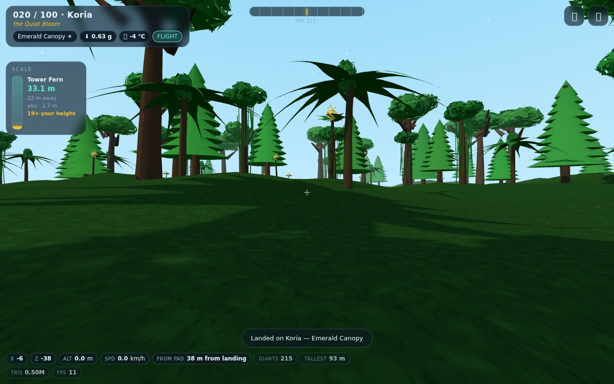

# 🪐 Giant Worlds

**100 planets, each covered in plants the size of skyscrapers — and you, 1.7 metres tall, walking between them.**



A first-person exploration sandbox built on the same vendored Three.js r170 as the racing game:
no build step, no CDN, everything (terrain, sky, 10 species of giant flora, water, spores) is
generated procedurally from a planet seed.

```bash
node tools/preview.mjs          # → http://localhost:8001/  (lands in the forest)
# or: python3 -m http.server 8000 → http://localhost:8000/worlds/
```

## What's in a world

- **Real-world scale.** Your eye is at 1.7 m. Titan Arbors reach 30–72 m, Umbrella Caps hold a
  30 m canopy, Giant Fungi glow at 40 m. The HUD scale panel always shows the nearest plant's
  height next to your 1.7 m and how many times taller it is than you.
- **100 seeded planets** in 10 biomes — Emerald Canopy, Crimson Spore Forest, Azure Lagoon,
  Amber Savanna, Violet Crystal Woods, Frostfern Tundra, Biolume Night Garden, Ashen Grove,
  Blossom Drift, Verdant Abyss — each with its own sky, sun/moon, gravity (0.55–1.55 g),
  temperature, water level, flora mix and size multiplier. Planet #37 is always the same planet.
- **Travel.** The star map (M) lists all 100 worlds with painted planet badges, biome, gravity,
  temperature and your explored counter; tap to warp. Next / Random buttons for lazy jumping.
- **Movement that respects the scale.** Walk 1.5 m/s, sprint 5.4, jump against the local gravity,
  and a flight suit (F) that lifts you above a 60 m canopy at 42 m/s. Trunks are solid; you can't
  walk through a tree.
- **Living detail.** Instanced forests (one draw call per material bucket), meadow patches of
  ferns and grass around your landing site, drifting pollen/spores, water with sun glitter,
  soft shadows, and an automatic one-time detail drop if a slow machine struggles.
- **Touch controls** (left stick walks, right side looks) plus full keyboard/mouse with pointer lock.

## Controls

| | |
|---|---|
| `W A S D` | walk |
| `Shift` | sprint / fly faster |
| `Space` | jump · rise while flying |
| `Ctrl` | descend while flying |
| `F` | flight suit |
| `M` | star map (100 worlds) |
| `R` | back to the landing site |
| `1 2 3` | detail low / med / high |
| click | grab the mouse to look |

Progress (which worlds you've explored, current world, detail level) is saved in `localStorage`.

## Code map

| file | what it does |
|---|---|
| `src/planets.js` | the 100-planet catalogue: seeds, biomes, palettes, names, gravity |
| `src/flora.js` | the 10 giant species + ground cover, built in metres (merged geometry) |
| `src/world.js` | terrain, sky dome, lights, water, instanced forest placement, spores |
| `src/explorer.js` | first-person body: physics, collisions, head-bob, flight |
| `src/main.js` | boot, render loop, HUD, star map, travel, quality, touch |
| `src/rng.js` | seeded RNG + Perlin/fBm noise shared by everything |

## Verification

`tools/verify-worlds.mjs` runs the real page in headless Chrome, drives the explorer at a fixed
60 Hz and builds all 100 worlds once — 26 assertions (walking pace, jump height against local
gravity, flight climb, trunk collisions, travel, HUD, memory, console cleanliness):

```bash
node tools/verify-worlds.mjs            # needs a Chrome/Chromium binary
```

`tools/shots.mjs` poses the camera (ground level / canopy level) on chosen planets and writes
screenshots.
